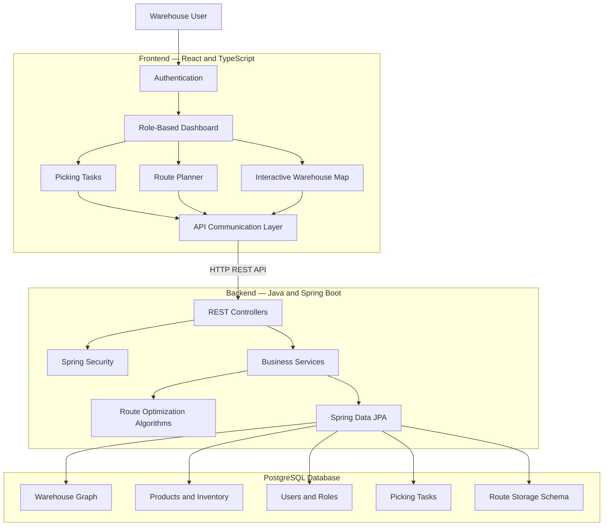
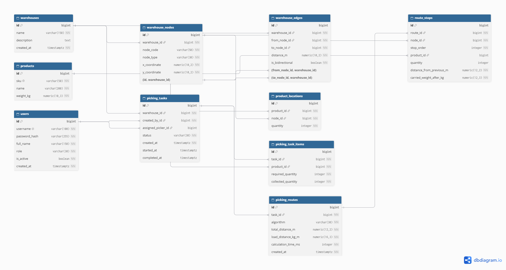
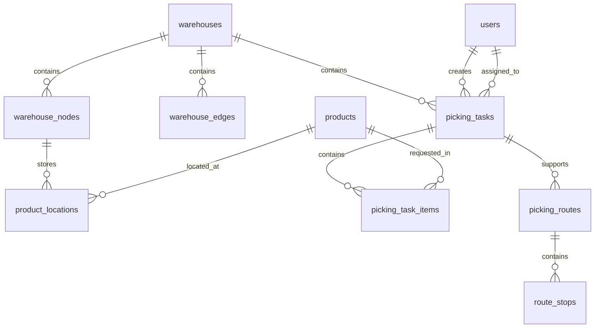
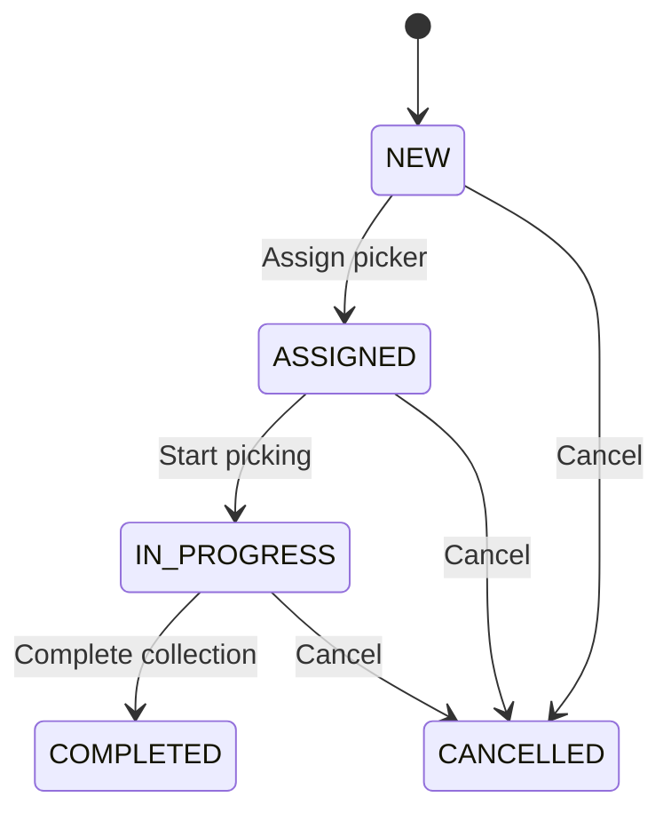
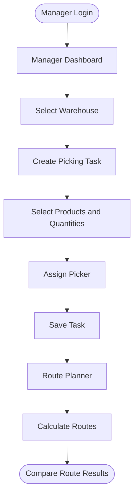
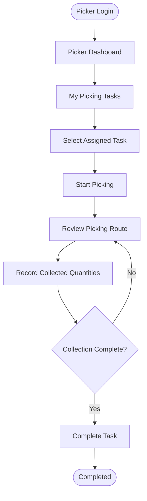
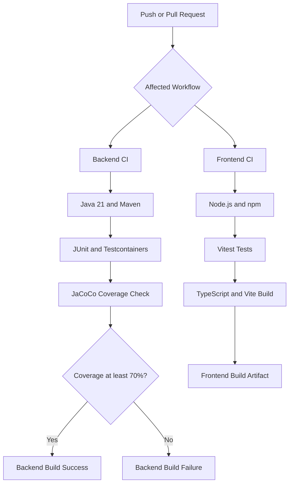

# Warehouse Picker Route Optimization Platform

**A warehouse management and order-picking platform with graph-based route planning, inventory location tracking, and performance comparison of picking strategies.**

Bachelor's project | Java 21 | Spring Boot | PostgreSQL | React | TypeScript

## 1. Project Overview

The Warehouse Picker Route Optimization Platform is a full-stack application designed to support warehouse order-picking operations and evaluate alternative collection routes.

The system represents a warehouse as a weighted graph consisting of entrances, exits, intersections, storage locations, and connections between them.

Warehouse managers can organize warehouse layouts, maintain user accounts, create picking tasks, and assign tasks to employees. Pickers can view assigned tasks, follow picking instructions, and record collected quantities.

The route-planning module calculates collection sequences and compares a weight-aware heuristic against an S-shape baseline.

The application is built using a Java Spring Boot backend, a PostgreSQL relational database, and a React single-page frontend.

## 2. Problem Statement

Order picking is one of the key operational processes in warehouse logistics.

When warehouse workers collect products from multiple storage locations, inefficient routes can increase:

- Walking distance.
- Time spent travelling between product locations.
- Physical effort associated with carrying collected items.
- Overall order-processing costs.

Traditional picking strategies, such as S-shape traversal, use predefined movement patterns that may not reflect the specific products, storage locations, and weights associated with each order.

This project investigates how a graph-based route-planning approach can support more efficient warehouse picking operations.

## 3. Project Objectives

The main objective is to develop a system that manages picking tasks and calculates warehouse collection routes while considering travel distance and accumulated product weight.

### Functional Objectives

1. Represent warehouse layouts as navigable graphs.
2. Store product information, weights, and warehouse storage locations.
3. Manage warehouse users and role-based access.
4. Create and assign picking tasks.
5. Track required and collected product quantities.
6. Calculate routes through warehouse navigation graphs.
7. Compare route-planning strategies using measurable criteria.
8. Visualize warehouse maps and picking sequences.
9. Provide REST API access and a web-based user interface.

### Evaluation Objectives

The route-planning methods are evaluated using:

| Metric | Unit | Description |
|---|---|---|
| Walking distance | m | Total distance travelled while collecting products |
| Load-distance | kg·m | Distance weighted by the load carried during movement |
| Route calculation time | ms | Time required to calculate a route |
| Picking stops | count | Number of collection locations included in the route |

The project evaluates whether the weight-aware heuristic can improve results compared with the S-shape baseline.

Any observed improvement must be supported by calculated results rather than assumed.

## 4. System Architecture

The application follows a layered architecture consisting of a web frontend, REST API, service layer, persistence layer, and PostgreSQL database.



### Architectural Responsibilities

| Layer | Responsibility |
|---|---|
| Frontend | User interface, forms, navigation, maps, and result visualization |
| Controllers | REST endpoints and request handling |
| Security | Authentication and role-based authorization |
| Services | Business rules, task lifecycle, and route calculation |
| Algorithms | Shortest-path calculation and picking-route strategies |
| Repositories | Database access through JPA |
| PostgreSQL | Persistent warehouse, product, user, and task data |

The route calculation API currently returns computed results directly. Although the database schema includes route-storage tables, newly calculated routes are not automatically persisted.

## 5. Technology Stack

| Component | Technology |
|---|---|
| Backend language | Java 21 |
| Backend framework | Spring Boot |
| REST API | Spring Web MVC |
| Persistence | Spring Data JPA / Hibernate |
| Database | PostgreSQL 17 |
| Database migrations | Flyway |
| Authentication | Spring Security HTTP Basic |
| Frontend | React 19 |
| Frontend language | TypeScript |
| Bundler | Vite 8 |
| Frontend testing | Vitest, React Testing Library |
| E2E testing | Playwright |
| Backend testing | JUnit 5, Mockito, Testcontainers |
| Coverage | JaCoCo |
| API documentation | OpenAPI 3.1, Swagger UI |
| Continuous integration | GitHub Actions |

### Technology Selection

**Java and Spring Boot** provide a structured environment for REST APIs, application services, security, and integration with relational databases.

**PostgreSQL** supports relational integrity, transactional operations, and structured storage of interconnected warehouse information.

**React and TypeScript** support reusable UI components, interactive maps, and typed communication with the backend.

**Flyway** provides version-controlled database migrations.

**GitHub Actions** supports automated build and test verification.

## 6. Database Architecture

The database uses PostgreSQL and follows a relational OLTP model.

The application schema is organized into five functional groups and contains **10 application tables**.

### Database Tables

| Functional Group | Table | Purpose |
|---|---|---|
| Warehouse structure | `warehouses` | Warehouse information |
| Warehouse structure | `warehouse_nodes` | Entrances, exits, intersections, storage positions |
| Warehouse structure | `warehouse_edges` | Connections, distances, and movement direction |
| Product storage | `products` | Product identifiers, names, and weights |
| Product storage | `product_locations` | Product quantities at specific storage nodes |
| User management | `users` | Accounts, roles, and authentication data |
| Picking operations | `picking_tasks` | Task ownership, assignment, status, and timestamps |
| Picking operations | `picking_task_items` | Required and collected product quantities |
| Route storage | `picking_routes` | Schema for storing calculated route information |
| Route storage | `route_stops` | Schema for storing ordered route stops |

The `flyway_schema_history` table is maintained separately by Flyway.

### Logical Database Diagram



### Data Relationships



The complete logical schema includes additional relationships between warehouse edges and their source/destination nodes, as well as route stops and storage nodes.

See the database schema documentation for the full relationship model.

### Database Normalization

The relational model is designed according to the principles of Third Normal Form (3NF).

The main entities are separated to reduce data redundancy and maintain referential integrity.

For example:

- Product names and weights are stored in `products`.
- Product quantities at individual locations are stored in `product_locations`.
- Picking task metadata is stored in `picking_tasks`.
- Individual products required for a task are stored in `picking_task_items`.
- User accounts are referenced through foreign keys rather than duplicated in task records.

### Data Integrity

The database uses:

- Primary keys and foreign keys.
- Unique constraints.
- NOT NULL constraints.
- CHECK constraints.
- PostgreSQL transactions.
- Controlled access through database roles.

These mechanisms support consistent warehouse and picking-task data.

### Database Documentation

- [Database Setup](docs/database/DATABASE_SETUP.md)
- [Database Schema](docs/database/DATABASE_SCHEMA.md)
- [Data Dictionary](docs/database/DATA_DICTIONARY.md)
- [ER Diagram](docs/database/database_schema.png)
- [Database Security Scripts](database/security/)
- [Test Data](database/seed/)
- [Database Tests](database/tests/)

## 7. Database Migrations

The schema is managed through five versioned Flyway migrations.

| Version | Description |
|---|---|
| V1 | Warehouse structure: warehouses, nodes, edges |
| V2 | Products and storage locations |
| V3 | Users and roles |
| V4 | Picking tasks and task items |
| V5 | Picking routes and route stops |

Migration files:

`backend/src/main/resources/db/migration/`

Flyway records applied migrations and their execution status in `flyway_schema_history`.

Database schema changes are managed through migration scripts rather than manual alterations to production tables.

## 8. Warehouse Graph Model

A warehouse is represented as a weighted, potentially directed graph.

### Node Types

| Node Type | Description |
|---|---|
| ENTRANCE | Starting location |
| EXIT | End location |
| INTERSECTION | Connection between warehouse paths |
| STORAGE | Product collection location |

Each node includes a unique identifier, warehouse association, code, type, and coordinates.

Edges describe movement between nodes, including distance in meters and whether movement is bidirectional.

### Graph-Based Navigation

The application uses Dijkstra's algorithm to calculate shortest paths between relevant warehouse nodes.

The warehouse graph allows the route-planning module to account for the actual connectivity of warehouse passages rather than assuming unrestricted straight-line movement.

## 9. Route Optimization

The application implements two route-planning approaches.

### Weight-Aware Heuristic

The weight-aware algorithm selects picking locations using a scoring rule based on travel distance and product weight.

The calculation accounts for the accumulated load carried between collection stops.

The heuristic aims to produce an efficient collection sequence but does not guarantee a globally optimal solution.

### S-Shape Baseline

The S-shape planner uses aisle coordinates to determine a traversal order, alternating movement direction between aisles.

It provides a comparison baseline for the weight-aware route.

### Route Evaluation

For each route, the backend returns:

- Ordered picking stops.
- Total walking distance.
- Total load-distance.
- Distance from the previous stop.
- Accumulated carried weight.
- Full path through warehouse nodes.

The frontend presents these results through the Route Planner.

Calculated routes are currently returned without being automatically stored in the route tables.

## 10. Picking Task Management

The picking-task subsystem supports two application roles.

### Manager

A manager can create picking tasks, select available products and required quantities, and assign tasks to pickers.

### Picker

A picker can view assigned tasks, start collection, update collected quantities, and complete tasks after satisfying the required quantities.

### Task Lifecycle



The database supports the statuses:

`NEW`, `ASSIGNED`, `IN_PROGRESS`, `COMPLETED`, and `CANCELLED`.

Task status changes and collection updates are handled by backend services.

The current picking workflow does not automatically reserve or deduct inventory stock when products are collected.

## 11. Frontend Application

The frontend is a React single-page application with role-specific dashboards.

### Implemented Pages

- Login.
- Manager Dashboard.
- Picker Dashboard.
- Warehouse Management.
- User Management.
- Warehouse Maps.
- Picking Tasks.
- Route Planner.
- Algorithm Information.

### Interactive Warehouse Maps

The map viewer provides:

- Warehouse graph visualization.
- Zooming and panning.
- Node searching.
- Fullscreen mode.
- Display of warehouse nodes and connections.

### Route Planner

Users select existing picking tasks and calculate collection routes without manually entering task identifiers.

The interface displays product names, collection sequences, distance metrics, and comparisons between algorithms.

Detailed frontend architecture, technology justification, and user flows:

[Frontend Documentation](frontend/README.md)

## 12. Main User Workflows

### Manager Workflow



### Picker Workflow



## 13. REST API

The Spring Boot backend exposes REST endpoints for authentication and warehouse operations.

| API Group | Example |
|---|---|
| Authentication | `GET /api/auth/me` |
| Warehouses | `/api/warehouses` |
| Users | `/api/users` |
| Warehouse maps | `/api/warehouses/{warehouseId}/map` |
| Picking tasks | `/api/tasks` |
| Available products | `/api/catalog/products` |
| Route calculation | `POST /api/routes/calculate/{taskId}` |

### Swagger UI

When the backend is running:

- Swagger UI: http://localhost:8080/swagger-ui.html
- OpenAPI JSON: http://localhost:8080/v3/api-docs
- OpenAPI YAML: http://localhost:8080/v3/api-docs.yaml

### API Documentation

- [OpenAPI Specification](docs/api/openapi.yaml)
- [API Reference](docs/api/API_REFERENCE.md)
- [Getting Started](docs/api/GETTING_STARTED.md)
- [Integration Tutorial](docs/api/INTEGRATION_TUTORIAL.md)
- [API Request Examples](docs/api/examples/)

The checked-in OpenAPI document must be regenerated and validated against the current backend before final submission.

## 14. Project Structure

```text
warehouse-picker-route-optimization/
├── .github/
│   └── workflows/
│       ├── backend-tests.yml
│       └── frontend-ci.yml
├── backend/
│   ├── src/main/java/
│   ├── src/main/resources/
│   ├── src/test/
│   ├── pom.xml
│   └── mvnw.cmd
├── frontend/
│   ├── src/
│   │   ├── api/
│   │   ├── components/
│   │   ├── pages/
│   │   ├── test/
│   │   └── types/
│   ├── e2e/
│   ├── README.md
│   ├── package.json
│   └── package-lock.json
├── database/
│   ├── security/
│   ├── seed/
│   └── tests/
├── docs/
│   ├── api/
│   ├── database/
│   └── frontend/
└── README.md
```

## 15. Getting Started

### Prerequisites

- Java Development Kit 21.
- Node.js compatible with Vite 8.
- npm.
- PostgreSQL 17 or a compatible PostgreSQL instance.
- Git.
- Docker Desktop for Docker-based database setup and Testcontainers integration tests.

### Backend Configuration

Configure the database connection through environment variables.

| Variable | Purpose |
|---|---|
| `DB_URL` | PostgreSQL JDBC URL |
| `DB_USERNAME` | Application database username |
| `DB_PASSWORD` | Application database password |
| `FLYWAY_USERNAME` | Migration account username |
| `FLYWAY_PASSWORD` | Migration account password |
| `INITIAL_MANAGER_USERNAME` | Optional initial manager username |
| `INITIAL_MANAGER_PASSWORD` | Optional initial manager password |
| `INITIAL_MANAGER_FULL_NAME` | Optional initial manager display name |

See [Database Setup](docs/database/DATABASE_SETUP.md) and [Backend Getting Started](docs/api/GETTING_STARTED.md) for complete configuration instructions.

### Start Backend

From the repository root:

```powershell
cd backend
.\mvnw.cmd spring-boot:run
```

Alternatively, run the backend through IntelliJ IDEA with the required environment variables.

Default API address:

http://localhost:8080

### Start Frontend

Open a separate terminal from the repository root:

```powershell
cd frontend
npm ci
npm run dev
```

Default frontend address:

http://localhost:5173

A working backend and configured database are required for authenticated operations.


## 16. Automated Testing

The Warehouse Picker Route Optimization Platform uses automated tests to verify backend business logic, warehouse route calculation, API security, database integration, and frontend workflows.

### Backend Testing

The backend test suite uses JUnit 5, Mockito, Spring Boot Test, MockMvc, and Testcontainers.

The tests cover:

- Graph shortest-path calculations and route optimization.
- Weight-aware and S-shape route-planning strategies.
- Picking task creation, assignment, collection, and completion.
- Task state transitions and role-based access restrictions.
- Warehouse management and graph validation.
- Inventory availability and route calculation prerequisites.
- Centralized exception handling.
- Spring Boot integration with PostgreSQL and Flyway.

The integration tests run against an isolated PostgreSQL 17 database managed by Testcontainers.

#### Verified Backend Test Results

| Metric | Result |
|---|---:|
| Total backend tests | 93 |
| Passed | 93 |
| Failed | 0 |
| Errors | 0 |
| Skipped | 0 |
| Instruction coverage | 77% |
| Branch coverage | 71% |
| Service instruction coverage | 83% |
| Service branch coverage | 80% |

Results were verified locally on November 23, 2026.

#### Running Backend Tests

From the repository root on Windows:

```powershell
cd backend
.\mvnw.cmd clean verify
```

The command compiles the application, runs the automated tests, generates the JaCoCo coverage report, and verifies the required coverage thresholds.

The HTML coverage report is available at:

`backend/target/site/jacoco/index.html`

### JaCoCo Coverage Quality Gate

The project uses JaCoCo 0.8.14 to measure backend code coverage.

The Maven build enforces the following minimum thresholds:

| Coverage Metric | Minimum | Verified |
|---|---:|---:|
| Instructions | 70% | 77% |
| Branches | 70% | 71% |

The coverage requirements are enforced during the Maven `verify` phase.

If either threshold is not met, the build fails.

Verified output:

```text
All coverage checks have been met.
BUILD SUCCESS
```

### Frontend Component Testing

The React frontend uses Vitest and React Testing Library.

| Component | Tests | Result |
|---|---:|---|
| ManagerDashboard | 2 | Passed |
| PickerDashboard | 2 | Passed |
| InteractiveWarehouseMap | 3 | Passed |
| **Total** | **7** | **Passed** |

Run from the repository root:

```powershell
cd frontend
npm ci
npm run test
```

### End-to-End Testing

Playwright and Chromium are used to verify browser-based workflows.

The two locally verified scenarios are:

1. Manager authentication, picking task navigation, and route calculation.
2. Picker authentication, assigned task navigation, and role-specific interface restrictions.

**Verified local result: 2 of 2 E2E tests passed.**

Run from the frontend directory:

```powershell
npm run test:e2e
```

The E2E tests require a running backend, a configured database, suitable test records, and dedicated manager and picker credentials.

Playwright E2E tests are not yet executed in GitHub Actions.

### Testing Documentation

Detailed testing documentation is available in:

- [Automated Testing and Coverage](docs/testing/AUTOMATED_TESTING.md)
- [Frontend Testing](docs/frontend/TESTING.md)
- [Front-End Assessment](docs/frontend/FRONTEND_CRITERION.md)

## 17. Continuous Integration

The repository uses GitHub Actions to run automated verification on repository changes.

### Backend CI

Workflow: `.github/workflows/backend-tests.yml`

The backend pipeline:

1. Checks out the repository.
2. Configures Java 21.
3. Runs Maven tests and integration tests.
4. Starts an isolated PostgreSQL environment through Testcontainers.
5. Generates JaCoCo coverage reports.
6. Enforces the 70% instruction and branch coverage thresholds.
7. Uploads test results and coverage reports as workflow artifacts.

The pipeline executes:

```bash
./mvnw --batch-mode clean verify
```

#### Verified Backend CI Execution

| Property | Value |
|---|---|
| Workflow | Backend Tests |
| Commit | `4a691b4` |
| Date | November 23, 2026 |
| Build | Success |
| Coverage Quality Gate | Passed |
| Test Report Artifact | `junit-test-results` |
| Coverage Report Artifact | `jacoco-report` |

The GitHub Actions logs confirm:

```text
All coverage checks have been met.
BUILD SUCCESS
```

[Successful Backend CI Run](https://github.com/Vladkosheliuk/warehouse-picker-route-optimization/actions/runs/45263297187)

### Frontend CI

Workflow: `.github/workflows/frontend-ci.yml`

The frontend pipeline performs dependency installation, Vitest component testing, TypeScript compilation, and production build verification.

The main commands are:

```bash
npm ci
npm run test
npm run build
```

The production build is uploaded as a GitHub Actions artifact.

Playwright E2E tests are currently verified locally and are not included in the frontend CI workflow.

### CI Workflow Overview



The automated workflows provide reproducible verification of the published application source.

[GitHub Actions](https://github.com/Vladkosheliuk/warehouse-picker-route-optimization/actions)

## 18. Security

The system uses Spring Security with HTTP Basic authentication and role-based authorization.

Supported application roles:

- `MANAGER`
- `PICKER`

Passwords are stored as hashes rather than plaintext.

Database access permissions are separated through PostgreSQL roles and a dedicated application account.

Application secrets must be supplied through environment variables and excluded from version control.

Frontend navigation restrictions do not replace backend authorization checks.

HTTPS is required before exposing authenticated application endpoints publicly.

## 19. Current Limitations and Further Development

The current implementation supports the main warehouse, picking-task, and route-comparison workflows.

Further development areas include:

- Complete product catalog and inventory management through the web interface.
- Automatic inventory reservation and stock deduction during picking.
- Persistence and historical analysis of calculated routes.
- Route visualization directly on the interactive warehouse floor graph.
- More extensive controlled experiments with larger warehouse layouts.
- Deployment of the complete application to an externally accessible environment.

The database schema already supports route records and ordered stops, but their automatic persistence is not part of the current route calculation API.

## 20. Project Evaluation

The project compares route-planning strategies based on measurable operational results.

The evaluation considers:

- Total walking distance.
- Accumulated load-distance.
- Picking order.
- Warehouse graph structure.
- Product quantities and weights.

The weight-aware heuristic is compared with the S-shape baseline.

Equal results between algorithms are valid experimental observations and do not demonstrate improvement.

Performance conclusions must be based on reproducible scenarios and measured outputs.

## 21. Project Documentation

| Area | Documentation |
|---|---|
| General project overview | This README |
| Frontend architecture and user flows | [Frontend README](frontend/README.md) |
| Frontend testing | [TESTING.md](docs/frontend/TESTING.md) |
| Front-end assessment | [FRONTEND_CRITERION.md](docs/frontend/FRONTEND_CRITERION.md) |
| API specification | [OpenAPI YAML](docs/api/openapi.yaml) |
| API documentation | [API Reference](docs/api/API_REFERENCE.md) |
| Backend setup | [Getting Started](docs/api/GETTING_STARTED.md) |
| API integration | [Integration Tutorial](docs/api/INTEGRATION_TUTORIAL.md) |
| Database setup | [Database Setup](docs/database/DATABASE_SETUP.md) |
| Database design | [Database Schema](docs/database/DATABASE_SCHEMA.md) |
| Database data dictionary | [Data Dictionary](docs/database/DATA_DICTIONARY.md) |
| Database diagram | [ER Diagram](docs/database/database_schema.png) |
| CI workflows | [GitHub Actions](https://github.com/Vladkosheliuk/warehouse-picker-route-optimization/actions) |

## 22. Repository

**GitHub Repository:**

https://github.com/Vladkosheliuk/warehouse-picker-route-optimization

**Public deployment:** Not available at this stage.

---

**Warehouse Picker Route Optimization Platform**

*Bachelor's Project — 2026*
