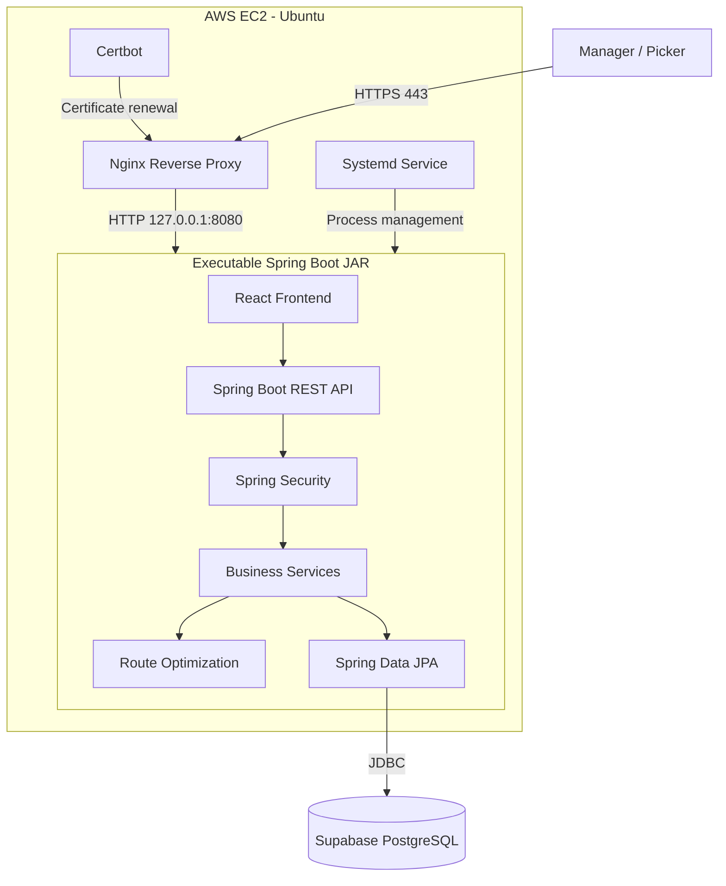

# Production Deployment

## 1. Overview

The Warehouse Picker Route Optimization Platform is deployed
on AWS EC2 and accessible over HTTPS.

The React frontend and Spring Boot backend are packaged
into a single executable JAR. PostgreSQL is hosted on Supabase.

Deployment verification date: November 25, 2026.

## 2. Application URLs

| Resource | URL |
|---|---|
| Public application | https://56.228.138.90/ |
| Health check | https://56.228.138.90/actuator/health |
| Swagger UI | https://56.228.138.90/swagger-ui/index.html |
| OpenAPI JSON | https://56.228.138.90/v3/api-docs |
| OpenAPI YAML | https://56.228.138.90/v3/api-docs.yaml |

Authentication is required for protected API endpoints.
The public Swagger endpoints require final verification.

## 3. Infrastructure

| Component | Technology |
|---|---|
| Cloud provider | Amazon Web Services |
| Hosting service | Amazon EC2 |
| AWS region | Europe (Stockholm), eu-north-1 |
| Operating system | Ubuntu |
| Java runtime | Java 21 |
| Backend | Spring Boot |
| Frontend | React, TypeScript, Vite |
| Database | Supabase PostgreSQL |
| ORM | Hibernate / Spring Data JPA |
| Reverse proxy | Nginx |
| Process management | systemd |
| TLS certificate | Let's Encrypt |
| Certificate management | Certbot |
| Continuous integration | GitHub Actions |

## 4. Deployment Architecture



The frontend and backend are served from the same origin.
A separate frontend server is not required in production.

## 5. Application Build

The fullstack application is built using the Maven wrapper.

Windows:

```powershell
cd backend
.\mvnw.cmd -Pfullstack clean verify
```

Linux:

```bash
cd backend
./mvnw -Pfullstack clean verify
```

Java 21 and Docker are required for the full build
and Testcontainers integration tests.

The Maven fullstack profile installs frontend dependencies,
builds the React application, packages its static resources,
runs backend tests and verifies JaCoCo coverage.

Generated application artifact:

`backend/target/backend-0.0.1-SNAPSHOT.jar`

The executable JAR is uploaded to the EC2 instance.

## 6. Environment Configuration

Production database settings are supplied through
environment variables:

- `DB_URL`
- `DB_USERNAME`
- `DB_PASSWORD`
- `FLYWAY_USERNAME`
- `FLYWAY_PASSWORD`

The environment file on the EC2 instance is:

`/etc/warehouse-picker.env`

The file is protected with permissions set to 600.

Database credentials are not stored in the repository
or embedded in the executable JAR.

Flyway applies database migrations during application startup.

## 7. Application Process Management

The application runs as a systemd service named:

`warehouse-picker`

Check the service status:

```bash
sudo systemctl status warehouse-picker
```

Restart the application:

```bash
sudo systemctl restart warehouse-picker
```

View application logs:

```bash
sudo journalctl -u warehouse-picker -n 100 --no-pager
```

The service is enabled to start automatically
when the EC2 instance boots.

Spring Boot uses structured ECS logging.

## 8. Network Configuration

Spring Boot listens on the local server interface:

`127.0.0.1:8080`

Nginx forwards incoming HTTPS requests to the application.

AWS Security Group configuration:

| Port | Protocol | Access |
|---|---|---|
| 22 | TCP | Restricted administrator IP |
| 80 | TCP | Public HTTP |
| 443 | TCP | Public HTTPS |
| 8080 | TCP | No public inbound rule |

HTTP requests are redirected to HTTPS, except for
ACME challenge requests required for certificate renewal.

## 9. HTTPS Configuration

HTTPS is provided by a Let's Encrypt IP address certificate.

Certbot manages certificate issuance and automatic renewal.

A deployment hook validates the Nginx configuration
and reloads Nginx after successful certificate renewal.

The following command was used to verify renewal:

```bash
sudo /snap/bin/certbot renew --dry-run --run-deploy-hooks
```

The simulated certificate renewal completed successfully.

The initial certificate expires on December 1, 2026.
The actual renewal should be verified before the assessment.

## 10. Deployment Verification

### Application Health

```bash
curl -i https://56.228.138.90/actuator/health
```

Observed result:

```json
{
  "groups": ["liveness", "readiness"],
  "status": "UP"
}
```

HTTP status: 200.

### HTTP to HTTPS Redirection

```bash
curl -I http://56.228.138.90/actuator/health
```

Observed result:

```text
HTTP/1.1 301 Moved Permanently
Location: https://56.228.138.90/actuator/health
```

### Authentication Verification

```bash
curl -i -X POST https://56.228.138.90/api/routes/calculate/1
```

Observed result:

```text
HTTP/1.1 401
WWW-Authenticate: Basic realm="Realm", charset="UTF-8"
```

The protected endpoint rejects unauthenticated requests.

## 11. Verification Summary

| Verification | Result |
|---|---|
| AWS EC2 deployment | Completed |
| Application startup | Successful |
| PostgreSQL connection | Successful |
| Flyway migrations | Successful |
| Nginx configuration | Valid |
| HTTPS certificate | Installed |
| Public health endpoint | HTTP 200 |
| HTTP to HTTPS redirection | HTTP 301 |
| Unauthorized API request | HTTP 401 |
| Certificate renewal simulation | Successful |
| Application autostart | Enabled |
| Nginx autostart | Enabled |
| Certbot renewal timer | Active |
| Backend port restricted to loopback | Verified |
| Authenticated production workflows | Pending final verification |

## 12. Automated Testing and CI

The automated tests run in isolated environments
and do not require access to the production database.

Verified CI results from November 24, 2026:

- Backend: 93 tests passed.
- Frontend: 7 component tests passed.
- Playwright: 2 end-to-end tests passed.
- JaCoCo: both 70% coverage thresholds satisfied.

GitHub Actions:

- [Backend Tests](https://github.com/Vladkosheliuk/warehouse-picker-route-optimization/actions/runs/45446623377)
- [Frontend CI](https://github.com/Vladkosheliuk/warehouse-picker-route-optimization/actions/runs/45444573211)
- [Playwright E2E](https://github.com/Vladkosheliuk/warehouse-picker-route-optimization/actions/runs/45444573097)

## 13. Related Documentation

- [Project README](../README.md)
- [Frontend Documentation](../frontend/README.md)
- [API Reference](api/API_REFERENCE.md)
- [Getting Started](api/GETTING_STARTED.md)
- [Database Setup](database/DATABASE_SETUP.md)
- [Automated Testing](testing/AUTOMATED_TESTING.md)