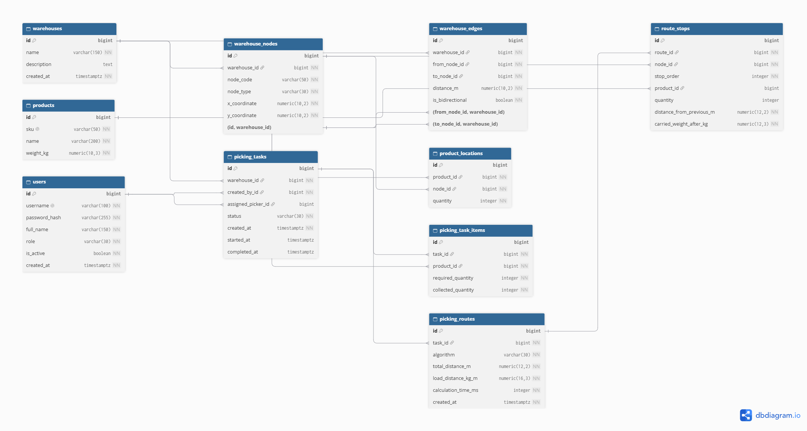

# Database Schema

**Project:** Warehouse Picker Route Optimization Platform  
**Database:** PostgreSQL  
**Schema:** `public`  
**Migration tool:** Flyway

## 1. Overview

The database stores warehouse layouts, product information, picking tasks, users, and route calculation results.

The database uses a transactional relational model (OLTP) implemented in PostgreSQL.

PostgreSQL was selected because the system requires structured data, relationships between entities, referential integrity, and reliable transactions for warehouse operations.

The database uses a single operational data layer in the `public` schema. Separate analytical data layers are not required for the current database design.

The application data model consists of 10 tables divided into five functional groups:

| Group | Tables |
|---|---|
| Warehouse structure | `warehouses`, `warehouse_nodes`, `warehouse_edges` |
| Product storage | `products`, `product_locations` |
| User management | `users` |
| Picking tasks | `picking_tasks`, `picking_task_items` |
| Route optimization | `picking_routes`, `route_stops` |

The `flyway_schema_history` table is maintained by Flyway and is not included in the application data model.

## 2. Logical Database Schema

The entity relationship diagram shows the application tables, their attributes, data types, primary keys, foreign keys, and relationships.

The diagram was created using dbdiagram.io.

## 3. Warehouse Structure

The warehouse layout is represented as a graph.

- `warehouses` stores general information about each warehouse.
- `warehouse_nodes` stores entrances, exits, intersections, and storage locations, including their coordinates.
- `warehouse_edges` stores connections between nodes, distances, and movement direction.

A warehouse can contain multiple nodes and edges. Each edge connects two nodes within the same warehouse.

The `is_bidirectional` field determines whether movement is allowed in both directions.

This structure is used to represent possible paths for warehouse pickers.

## 4. Product Storage

The `products` table stores product identifiers, names, and individual product weights.

The `product_locations` table links products to warehouse nodes and stores the quantity available at each location.

Products and warehouse nodes have a many-to-many relationship implemented through `product_locations`.

The combination of `product_id` and `node_id` is unique, preventing duplicate stock records for the same product at the same location.

Product weight is used as an input for the implemented weight-aware route optimization heuristic.

## 5. Users and Picking Tasks

The `users` table stores application users with two supported roles:

- `MANAGER` — manages warehouse data, creates picker
  accounts, creates picking tasks, and assigns tasks
  to pickers.
- `PICKER` — performs assigned picking tasks and
  confirms collected products.

The `picking_tasks` table stores tasks associated with a warehouse.

Each task references its creator through `created_by_id` and may reference an assigned picker through `assigned_picker_id`.

The `picking_task_items` table stores the products required for each task, together with their required and collected quantities.

Supported task statuses are:

`NEW`, `ASSIGNED`, `IN_PROGRESS`, `COMPLETED`, `CANCELLED`.

Database constraints ensure that required quantities are positive and collected quantities do not exceed required quantities.

## 6. Picking Routes

The `picking_routes` table stores route calculation results associated with picking tasks.

A task can have multiple routes, allowing different routing strategies to be compared.

The database supports two algorithm identifiers:

- `S_SHAPE` — baseline picking strategy.
- `OPTIMIZED` — implemented weight-aware route optimization heuristic.

The following metrics are stored for each route:

| Column | Unit | Description |
|---|---|---|
| `total_distance_m` | m | Total walking distance |
| `load_distance_kg_m` | kg·m | Accumulated carried weight multiplied by travel distance |
| `calculation_time_ms` | ms | Route calculation time |

The `route_stops` table stores the ordered sequence of warehouse nodes visited along a route.

Each stop records its sequence number, distance from the previous stop, and carried weight after the stop.

Product and quantity fields are optional because a route may include navigation stops where no products are collected.

The combination of `route_id` and `stop_order` is unique.

The route tables are implemented in the database schema
and can contain predefined demonstration records.

However, the current route calculation API does not
automatically persist newly calculated routes.
The calculated results are returned directly to the client.

## 7. Table Relationships

The main relationships in the database are:

| Parent table | Child table | Relationship |
|---|---|---|
| `warehouses` | `warehouse_nodes` | One-to-many |
| `warehouses` | `warehouse_edges` | One-to-many |
| `warehouses` | `picking_tasks` | One-to-many |
| `warehouse_nodes` | `warehouse_edges` | One-to-many (source node) |
| `warehouse_nodes` | `warehouse_edges` | One-to-many (destination node) |
| `products` | `product_locations` | One-to-many |
| `warehouse_nodes` | `product_locations` | One-to-many |
| `users` | `picking_tasks` | One-to-many (task creator) |
| `users` | `picking_tasks` | One-to-many (assigned picker) |
| `picking_tasks` | `picking_task_items` | One-to-many |
| `products` | `picking_task_items` | One-to-many |
| `picking_tasks` | `picking_routes` | One-to-many |
| `picking_routes` | `route_stops` | One-to-many |
| `warehouse_nodes` | `route_stops` | One-to-many |
| `products` | `route_stops` | One-to-many |

The assigned picker in `picking_tasks` and the collected product in `route_stops` are optional relationships. Their foreign key columns allow `NULL` values.

The source and destination node relationships in `warehouse_edges` use composite foreign keys to ensure that both nodes belong to the same warehouse.

## 8. Database Normalization (3NF)

The database uses a relational data model designed according to the principles of Third Normal Form (3NF). Normalization reduces data redundancy, prevents update anomalies, and improves data consistency.

### First Normal Form (1NF)

The database follows First Normal Form:

- Each table has a primary key that uniquely identifies its records.
- Each column contains atomic values.
- Repeating groups and multiple values within a single field are avoided.

For example, products required for a picking task are stored as individual records in `picking_task_items` instead of storing a list of products in the `picking_tasks` table.

### Second Normal Form (2NF)

The database follows Second Normal Form by ensuring that non-key attributes depend on the complete candidate key.

For example:

- In `product_locations`, the quantity depends on the combination of `product_id` and `node_id`.
- In `picking_task_items`, the required and collected quantities depend on the combination of `task_id` and `product_id`.
- In `route_stops`, each stop is uniquely identified within a route by the combination of `route_id` and `stop_order`.

These relationships prevent partial dependencies and unnecessary duplication of information.

### Third Normal Form (3NF)

The database follows Third Normal Form principles by separating independent entities and avoiding transitive dependencies between non-key attributes.

The following design decisions support normalization:

| Table | Normalization principle |
|---|---|
| `warehouses` | Warehouse information is stored independently from its nodes, edges, and tasks. |
| `warehouse_nodes` | Node information is stored separately and references its warehouse. |
| `warehouse_edges` | Connections reference existing warehouse nodes instead of duplicating node coordinates. |
| `products` | Product names, SKUs, and weights are stored in a dedicated table. |
| `product_locations` | Product availability is stored separately for each warehouse location. |
| `users` | User information is stored independently from picking tasks. |
| `picking_tasks` | Task information references existing warehouses and users. |
| `picking_task_items` | Required products and quantities are stored separately from task information. |
| `picking_routes` | Route calculation results are stored separately from picking tasks. |
| `route_stops` | Individual route stops are stored separately from route-level information. |

For example, `picking_task_items` stores a reference to a product through `product_id`. Product names and weights are not duplicated in this table. Changes to product information are managed in the `products` table.

Similarly, picking tasks reference users through `created_by_id` and `assigned_picker_id` rather than storing their names and account information.

### Design Considerations

The database includes selected calculated values to support route evaluation and historical result storage:

- `total_distance_m` — total calculated route distance.
- `load_distance_kg_m` — calculated accumulated weight-distance cost.
- `carried_weight_after_kg` — accumulated carried weight after a route stop.
- `calculation_time_ms` — time required to calculate a route.

These values are intentionally stored as route calculation results to support performance comparison between the S-shape and weight-aware routing strategies.

The `warehouse_edges` table also stores `warehouse_id` together with its endpoint identifiers. This controlled redundancy supports composite foreign key constraints that ensure both connected nodes belong to the same warehouse.

These design decisions introduce limited, intentional redundancy to support data integrity and route evaluation. The remaining core entities are separated according to Third Normal Form principles.

## 9. Data Integrity

All application tables use `BIGINT` primary keys generated by PostgreSQL identity columns.

Data integrity is maintained through:

- Primary keys for unique record identification.
- Foreign keys for referential integrity.
- Unique constraints for business identifiers and column combinations.
- `NOT NULL` constraints for required fields.
- `CHECK` constraints for valid quantities, weights, distances, roles, statuses, and timestamps.

Some business rules require application-level validation. These include verifying user roles during task assignment, ensuring that a task contains at least one product, and checking that route stops belong to the warehouse associated with the task.

Detailed column definitions and constraints are provided in the [Data Dictionary](DATA_DICTIONARY.md).

## 10. Transaction Management

The database uses PostgreSQL transactions to ensure consistency and reliability during warehouse operations.

Transactions follow the ACID principles:

- **Atomicity:** All operations within a transaction succeed together or are rolled back together.
- **Consistency:** Database constraints ensure that transactions preserve valid data.
- **Isolation:** Concurrent transactions are managed to prevent inconsistent updates.
- **Durability:** Committed changes are preserved by the database.

### Transaction Scenarios

| Operation | Transaction scope | Implementation |
|---|---|---|
| Create picking task | Create the task and its required items within one transaction. | Implemented |
| Assign picking task | Update the assigned picker and task status. | Implemented |
| Confirm product collection | Update the collected quantity of a task item. | Implemented |
| Complete picking task | Validate collected quantities and update the task status and completion timestamp. | Implemented |
| Deduct inventory stock | Reduce available inventory when products are collected. | Not implemented |
| Persist calculated routes | Store calculated route results and ordered route stops. | Not implemented |

The current picking workflow records collected quantities
but does not automatically deduct warehouse stock.

Route calculation results are returned by the REST API
without automatically saving them to the database.

The database schema supports route persistence, and the
demonstration dataset includes example stored routes.

### Transaction Handling

Application-level transactions are managed using Spring's
`@Transactional` annotation in the service layer.

Picking task creation, assignment, collection updates,
completion, and cancellation use transactional service methods.

If an operation fails, the transaction will be rolled back to prevent partially saved or inconsistent data.

For concurrent stock updates, the application must validate stock availability and use appropriate locking or atomic database updates to prevent negative inventory quantities.

PostgreSQL constraints provide database-level validation, while application transactions ensure consistency across related tables.

## 11. Database Creation

The database schema is created through five versioned Flyway SQL migrations located in:

[backend/src/main/resources/db/migration/](../../backend/src/main/resources/db/migration/)

Flyway applies pending migrations in version order when the backend starts and records their execution in `flyway_schema_history`.

The SQL migrations are the source of truth for the database structure. The logical schema and data dictionary document the structure defined by these migrations.

## 12. Database Security

The database implements role-based access control and follows the principle of least privilege.

### Database Roles

| Role | Description |
|---|---|
| `postgres` | Administrative account used for database management and schema migrations. |
| `app_read` | Read-only role for accessing application data without modifying records. |
| `app_write` | Application role with permissions to read and modify application data. |
| `warehouse_app` | Dedicated database login account that inherits permissions from `app_write`. |

The backend connects to PostgreSQL using the restricted `warehouse_app` account.

The application account cannot create databases, create roles, create tables in the `public` schema, or modify Flyway migration history.

Database administration and schema migrations are separated from normal application operations.

### Application Roles

Application-level roles are stored in the `users` table:

- `MANAGER` — manages warehouse information, creates picker accounts, and assigns picking tasks.
- `PICKER` — performs assigned picking tasks and records collected products.

Application roles are independent of PostgreSQL roles.
Their permissions are enforced by Spring Security and backend service-level authorization checks.

### Password Protection

Application user passwords are stored in the `password_hash` column rather than as plaintext passwords.

The `app_read` role cannot access password hashes. The backend has access to password hashes for authentication purposes.

Database connection credentials are supplied through environment variables and must not be committed to the repository.

### Security Verification

Database permission tests confirmed that:

- Application roles do not have superuser privileges.
- Read-only access does not permit data modification.
- The read-only role cannot access password hashes.
- Application roles cannot create tables in the `public` schema.
- The application role cannot modify Flyway migration history.
- The backend successfully connects using `warehouse_app`.

Security configuration scripts are available in [database/security/](../../database/security/).

## 13. Database Testing

The database was populated with 80 demonstration records across all ten application tables.

The test dataset includes warehouse nodes and edges, products with different weights, stock locations, manager and picker accounts, picking tasks, and example picking routes.

### Constraint Tests

| Test | Result |
|---|---|
| Negative product weight | Passed |
| Duplicate product SKU | Passed |
| NULL product name | Passed |
| Invalid foreign key reference | Passed |
| Negative stock quantity | Passed |

### Transaction Tests

A transaction test verified the atomic creation of a picking task and its items.

The test created a task, inserted a valid item, and attempted to insert an item with an invalid quantity. PostgreSQL rejected the invalid item and rolled back the transaction block.

The test confirmed that neither the task nor its previously inserted item remained in the database.

**Result:** Passed.

### Test Scripts

- [Test Data](../../database/seed/01_seed_test_data.sql)
- [Constraint Tests](../../database/tests/01_test_constraints.sql)
- [Transaction Tests](../../database/tests/02_test_transactions.sql)
- [Permission Tests](../../database/security/03_verify_permissions.sql)

## 14. Related Documentation

- [Database Setup](DATABASE_SETUP.md)
- [Data Dictionary](DATA_DICTIONARY.md)
- [Logical Database Diagram](database_schema.png)
- [SQL Migrations](../../backend/src/main/resources/db/migration/)
- [Project README](../../README.md)
