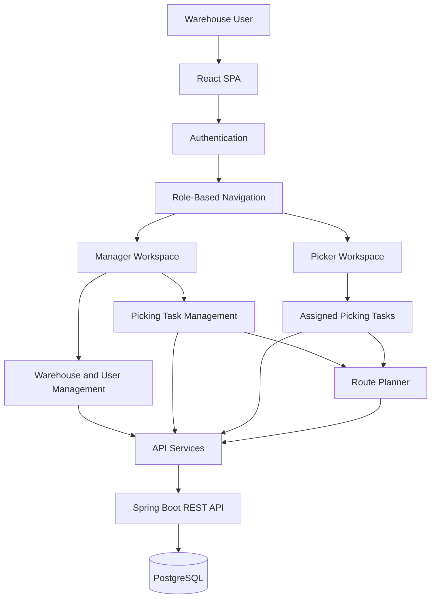
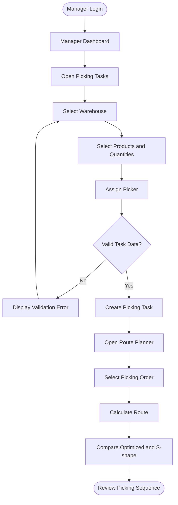
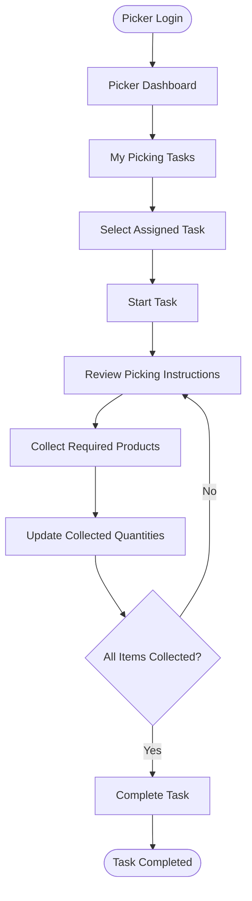

# Front-End Assessment — Implementation and Evidence

## 1. Project Information

**Project:** Warehouse Picker Route Optimization Platform

**Application:** PickerRoute

**Frontend:** React, TypeScript, Vite

**Backend:** Java, Spring Boot, PostgreSQL

**Repository:** https://github.com/Vladkosheliuk/warehouse-picker-route-optimization

**Frontend directory:** `frontend/`

## 2. Criterion Overview

The frontend provides a Single Page Application for warehouse picking operations.

The application supports two user roles:

- Manager — warehouse administration, user management, picking task creation, assignment, and route calculation.
- Picker — assigned task management, collection progress, and picking route access.

The interface communicates with the Spring Boot REST API using authenticated HTTP requests.

## 3. Requirements and Implementation

| Requirement | Implementation | Evidence |
|---|---|---|
| SPA using a modern framework | React 19 application | `frontend/src/App.tsx` |
| Modern bundler | Vite 8 | `frontend/vite.config.ts` |
| Architecture diagram | Frontend/backend architecture diagram | `frontend/README.md` |
| User flows | Manager, picker, and route calculation workflows | `frontend/README.md` |
| Technology justification | Explanation of React, TypeScript, Vite, and testing technologies | `frontend/README.md` |
| Component-based structure | Separate pages and reusable components | `frontend/src/pages/`, `frontend/src/components/` |
| API communication services | Dedicated TypeScript API modules | `frontend/src/api/` |
| Form validation | Validation in authentication and management workflows | Frontend pages and backend validation |
| Error handling | API/page error states and React Error Boundary | `frontend/src/api/`, `frontend/src/components/AppErrorBoundary.tsx` |
| Loading states | React request state and disabled controls | Frontend pages |
| Tests for at least three components | Three tested components, seven passing tests | `frontend/src/test/` |
| One or two E2E tests | Two passing Playwright scenarios | `frontend/e2e/warehouse-workflows.spec.ts` |

## 4. Frontend Architecture

The application separates presentation, state management, and backend communication.



### Component Organization

The frontend is divided into:

1. Application entry point and navigation.
2. Authentication and role-specific dashboards.
3. Warehouse management pages.
4. Warehouse map visualization.
5. Picking task management pages.
6. Route calculation and comparison.
7. API client modules.
8. Automated component and browser tests.

This organization separates responsibilities and supports maintainability and testing.

## 5. Manager User Flow



The manager can create picking tasks and evaluate collection routes based on the selected warehouse layout and product locations.

## 6. Picker User Flow



The picker works with tasks assigned to their account and can update collection progress through the supported backend operations.

## 7. Route Calculation and Visualization

The Route Planner allows users to select an existing picking task and calculate warehouse routes.

The application compares two routing approaches:

| Algorithm | Description |
|---|---|
| Weight-aware heuristic | Selects the next picking location using graph distance and item weight |
| S-shape baseline | Uses an aisle-based traversal order as a comparison method |

The results include:

- Total walking distance in meters.
- Load-distance in kg·m.
- Product collection sequence.
- Required quantity at each stop.
- Storage node identifiers.
- Distance between consecutive stops.
- Complete warehouse graph path.

The heuristic is not presented as a mathematically guaranteed global optimum.

## 8. Forms and User Feedback

The frontend provides forms for:

- User authentication.
- Warehouse management.
- User account management.
- Picking task creation.
- Warehouse map import.
- Route selection.

The application uses controlled form inputs and client-side checks where applicable.

The backend validates domain-specific operations such as authorization, inventory availability, and task state transitions.

The interface provides loading indicators, disabled controls, and error messages during asynchronous operations.

The React Error Boundary is mounted around the application in `frontend/src/main.tsx` and provides a fallback interface when an unexpected React rendering error occurs.

## 9. Automated Test Evidence

### Component Testing

| Component | Passing Tests |
|---|---:|
| ManagerDashboard | 2 |
| PickerDashboard | 2 |
| InteractiveWarehouseMap | 3 |
| **Total** | **7** |

Local test result:

```text
Test Files  3 passed (3)
Tests       7 passed (7)
```

### End-to-End Testing

| Scenario | Result |
|---|---|
| Manager login, task navigation, and route calculation | Passed |
| Picker login, assigned task navigation, and role restrictions | Passed |

Local test result:

```text
2 passed (16.9s)
```

See [Frontend Testing](TESTING.md) for execution instructions and detailed scenarios.

## 10. Build and Execution

### Install Dependencies

```bash
cd frontend
npm ci
```

### Start the Development Server

```bash
npm run dev
```

Default local frontend address:

http://localhost:5173

The backend must be running on port `8080`.

### Run Component Tests

```bash
npm run test
```

### Run End-to-End Tests

```bash
npm run test:e2e
```

The E2E tests require a running backend and environment variables containing the credentials of dedicated test accounts.

### Build the Application

```bash
npm run build
```

The production build has been verified successfully in the local development environment.

## 11. Continuous Integration

Frontend continuous integration is configured in:

`.github/workflows/frontend-ci.yml`

The workflow performs:

1. Repository checkout.
2. Node.js environment setup.
3. Dependency installation.
4. Component test execution.
5. TypeScript and production build verification.
6. Production artifact upload.

The frontend CI workflow is published on GitHub and
previously completed successfully.

It runs the seven Vitest component tests, validates the
TypeScript and Vite production build, and uploads the
frontend build artifact.

The latest local documentation and fullstack changes
have not yet been pushed or verified by GitHub Actions.

Playwright end-to-end testing is configured separately in
`.github/workflows/playwright-e2e.yml`.

The workflow starts a temporary PostgreSQL database and
Spring Boot backend before running the two Chromium scenarios.

The Playwright workflow has not yet been verified through
a successful GitHub Actions execution.


## 12. Security

The frontend uses role-specific navigation and authenticated requests.

The backend is responsible for enforcing authorization and validating protected operations.

Passwords and secret keys are not required in the repository. Local E2E credentials are supplied through environment variables.

Frontend access controls do not replace server-side authorization.

## 13. Submission Materials

The Front-end criterion submission consists of:

| Material | Location |
|---|---|
| Source code | `frontend/src/` |
| Frontend README | `frontend/README.md` |
| Architecture and user flows | `frontend/README.md` |
| Component tests | `frontend/src/test/` |
| E2E tests | `frontend/e2e/` |
| Playwright E2E workflow | `.github/workflows/playwright-e2e.yml` |
| Testing documentation | `docs/frontend/TESTING.md` |
| Criterion documentation | `docs/frontend/FRONTEND_CRITERION.md` |
| GitHub Actions workflow | `.github/workflows/frontend-ci.yml` |
| Repository | https://github.com/Vladkosheliuk/warehouse-picker-route-optimization |

No public frontend deployment URL is provided at this stage.

## 14. Verification Status

| Item | Status |
|---|---|
| React SPA implementation | Implemented |
| Production build | Verified locally |
| Architecture diagram | Documented |
| User flows | Documented |
| Technology justification | Documented |
| Component-based structure | Implemented |
| API service modules | Implemented |
| Form validation and error states | Implemented; final integration check required |
| Component tests | 7/7 passed |
| E2E tests | 2/2 passed |
| GitHub Actions | Previously verified; latest local changes pending publication |
| Repository publication | Latest local changes must be pushed |

---

**Warehouse Picker Route Optimization Platform**

*Front-End Assessment — 2026*
