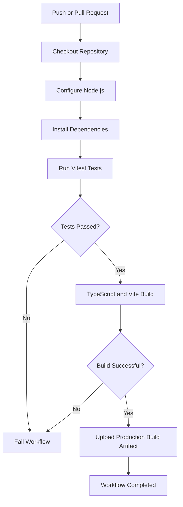

# Frontend Testing

## 1. Overview

The Warehouse Picker Route Optimization Platform uses automated testing to verify the functionality of its React frontend.

The testing strategy includes:

- Component tests using Vitest and React Testing Library.
- End-to-end tests using Playwright and Chromium.
- TypeScript validation and production builds using Vite.
- Continuous integration using GitHub Actions.

The tests cover dashboard functionality, warehouse map interaction, authentication, role-based navigation, and picking route calculation.

## 2. Testing Technologies

| Technology | Purpose |
|---|---|
| Vitest | Component test execution |
| React Testing Library | React component rendering and interaction |
| jsdom | Browser-like environment for component tests |
| Playwright | End-to-end browser automation |
| Chromium | Browser used for E2E verification |
| TypeScript | Static type checking |
| Vite | Production build validation |
| GitHub Actions | Automated testing and build verification |

## 3. Test Organization

The frontend tests are organized into separate directories.

```text
frontend/
├── src/
│   └── test/
│       ├── setup.ts
│       ├── ManagerDashboard.test.tsx
│       ├── PickerDashboard.test.tsx
│       └── InteractiveWarehouseMap.test.tsx
├── e2e/
│   └── warehouse-workflows.spec.ts
├── vitest.config.ts
├── playwright.config.ts
└── package.json
```

Component tests are located in `src/test/`.

End-to-end tests are located in `e2e/`.

## 4. Component Testing

Three key React components are covered by automated tests.

### 4.1 ManagerDashboard

**Test file:** `frontend/src/test/ManagerDashboard.test.tsx`

| Test | Expected Result |
|---|---|
| Displays the manager workspace | The manager dashboard and management sections are rendered |
| Opens warehouse management | Clicking the warehouse management button triggers the corresponding navigation callback |

**Result:** 2 tests passed.

### 4.2 PickerDashboard

**Test file:** `frontend/src/test/PickerDashboard.test.tsx`

| Test | Expected Result |
|---|---|
| Displays the picker workspace | The picker dashboard displays the authenticated employee's username |
| Updates the authenticated username | The component displays the updated username after receiving new properties |

**Result:** 2 tests passed.

### 4.3 InteractiveWarehouseMap

**Test file:** `frontend/src/test/InteractiveWarehouseMap.test.tsx`

| Test | Expected Result |
|---|---|
| Renders the warehouse graph | The map is rendered with its initial zoom level |
| Zooms into the warehouse map | Clicking the zoom-in button increases the zoom level |
| Finds a storage node | Searching for a node displays its identifier and storage type |

**Result:** 3 tests passed.

### 4.4 Component Test Results

| Component | Tests | Passed | Failed |
|---|---:|---:|---:|
| ManagerDashboard | 2 | 2 | 0 |
| PickerDashboard | 2 | 2 | 0 |
| InteractiveWarehouseMap | 3 | 3 | 0 |
| **Total** | **7** | **7** | **0** |

The latest local execution completed successfully.

```text
Test Files  3 passed (3)
Tests       7 passed (7)
```

## 5. End-to-End Testing

End-to-end tests verify complete user workflows in a real Chromium browser.

**Test file:** `frontend/e2e/warehouse-workflows.spec.ts`

### 5.1 Manager Workflow

**Scenario:** Manager can access picking tasks and calculate a route.

Test sequence:

1. Open the frontend application.
2. Enter valid manager credentials.
3. Authenticate through the backend API.
4. Verify that manager navigation is available.
5. Open the Picking Tasks page.
6. Open the Route Planner.
7. Select an existing picking order.
8. Calculate the picking route.
9. Verify that the route comparison is displayed.

**Expected result:** The manager can access the required pages and obtain route calculation results.

**Actual result:** Passed.

### 5.2 Picker Workflow

**Scenario:** Picker can access assigned tasks without manager controls.

Test sequence:

1. Open the frontend application.
2. Enter valid picker credentials.
3. Authenticate through the backend API.
4. Verify that manager-only navigation is unavailable.
5. Open My Picking Tasks.
6. Verify that the picker workspace is accessible.

**Expected result:** The picker can access their workspace without seeing manager-only navigation options.

**Actual result:** Passed.

### 5.3 End-to-End Test Results

| Scenario | Browser | Result |
|---|---|---|
| Manager authentication, picking tasks and route calculation | Chromium | Passed |
| Picker authentication and role-specific navigation | Chromium | Passed |
| **Total** | | **2 passed** |

Latest verified local execution:

```text
Running 2 tests using 1 worker

ok 1 - manager can access tasks and calculate a route
ok 2 - picker can access assigned tasks without manager controls

2 passed (16.9s)
```

These tests verify frontend workflows. Backend authorization is tested separately because hidden navigation controls do not provide API-level access protection.

## 6. Running Component Tests

### Prerequisites

- Node.js compatible with Vite 8.
- npm.
- Installed frontend dependencies.

From the project root:

```bash
cd frontend
npm ci
```

Execute the component tests:

```bash
npm run test
```

Vitest runs the component tests and reports the number of passed and failed test cases.

## 7. Running End-to-End Tests

The end-to-end tests require:

- A running Spring Boot backend on port `8080`.
- A frontend development server, started automatically by Playwright when required.
- A configured PostgreSQL database.
- Active manager and picker test accounts.
- An existing picking task with available warehouse inventory.

Install the Chromium browser:

```bash
npx playwright install chromium
```

Configure the following environment variables:

| Environment Variable | Description |
|---|---|
| `E2E_MANAGER_USERNAME` | Manager test account username |
| `E2E_MANAGER_PASSWORD` | Manager test account password |
| `E2E_PICKER_USERNAME` | Picker test account username |
| `E2E_PICKER_PASSWORD` | Picker test account password |

Run the tests:

```bash
npm run test:e2e
```

Playwright starts Chromium, performs the configured workflows, and generates test results.

### Viewing the Playwright Report

```bash
npx playwright show-report
```

The HTML report provides execution results and debugging information for unsuccessful scenarios.

Test-account passwords must not be stored in repository files.

## 8. Production Build Verification

The frontend production build includes TypeScript validation and Vite bundling.

Run:

```bash
npm run build
```

The command executes:

```text
tsc -b && vite build
```

A successful build confirms that the frontend passes TypeScript compilation and that production assets can be generated.

The output is stored in:

```text
frontend/dist/
```

**Latest local result:** Successful.

## 9. Continuous Integration

The frontend CI workflow is defined in:

`.github/workflows/frontend-ci.yml`

The workflow is configured to perform the following operations:



### CI Checks

| Check | Command |
|---|---|
| Install dependencies | `npm ci` |
| Component tests | `npm run test` |
| Production build | `npm run build` |

Playwright E2E tests are configured in the dedicated
GitHub Actions workflow `.github/workflows/playwright-e2e.yml`.

The workflow uses a temporary PostgreSQL 17 database,
starts the Spring Boot backend, and executes the
Chromium E2E scenarios.

The workflow results are available in GitHub Actions
after execution.

The frontend CI workflow has been published and
previously verified successfully on GitHub Actions.

### Verified CI Results

On November 24, 2026, all three GitHub Actions workflows
completed successfully for commit `cd9eb4e`:

- Backend Tests — passed.
- Frontend CI — passed.
- Playwright E2E — passed.

Latest verified CI runs:

- [Frontend CI](https://github.com/Vladkosheliuk/warehouse-picker-route-optimization/actions/runs/45444573211)
- [Playwright E2E](https://github.com/Vladkosheliuk/warehouse-picker-route-optimization/actions/runs/45444573097)
- [Backend Tests](https://github.com/Vladkosheliuk/warehouse-picker-route-optimization/actions/runs/45446623377)

The Playwright workflow uses an isolated PostgreSQL 17
database and executes both Chromium E2E scenarios.

## 10. Test Coverage Scope

The current automated frontend test suite validates:

- Rendering of role-specific dashboards.
- Dashboard navigation behavior.
- Display of authenticated user information.
- Warehouse map rendering.
- Warehouse map zoom controls.
- Warehouse node searching.
- Manager authentication and navigation.
- Manager route calculation workflow.
- Picker authentication and role-specific navigation.

The component test suite contains seven passing tests, and the browser test suite contains two passing scenarios.

The results confirm the tested behaviors; they do not represent a measured percentage of total frontend code coverage.

The application is deployed on AWS EC2 and accessible via HTTPS.

Public application: https://56.228.138.90/

Automated frontend and E2E tests are executed in isolated test
environments rather than against the production database.

## 11. Verification Summary

| Verification | Local Result |
|---|---|
| Component tests | 7/7 passed |
| Tested React components | 3 |
| Playwright E2E tests | 2/2 passed |
| Browser | Chromium |
| TypeScript and Vite build | Successful |
| GitHub Actions | Successfully verified |


The implemented tests satisfy the frontend assessment requirement of testing at least three key components and providing one or two end-to-end tests.

---

**Project:** Warehouse Picker Route Optimization Platform

**Repository:** https://github.com/Vladkosheliuk/warehouse-picker-route-optimization
