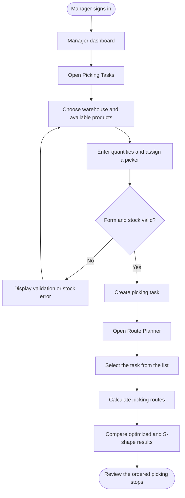
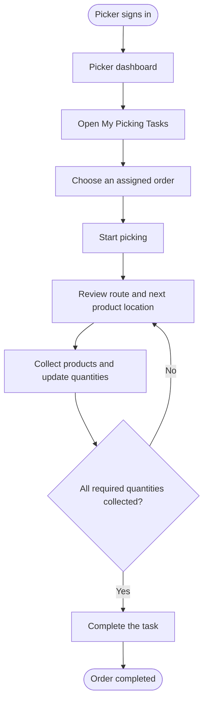
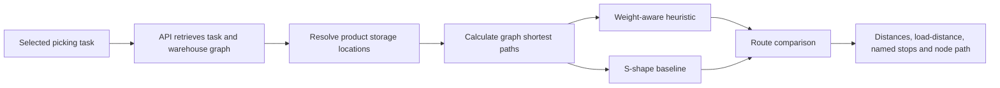
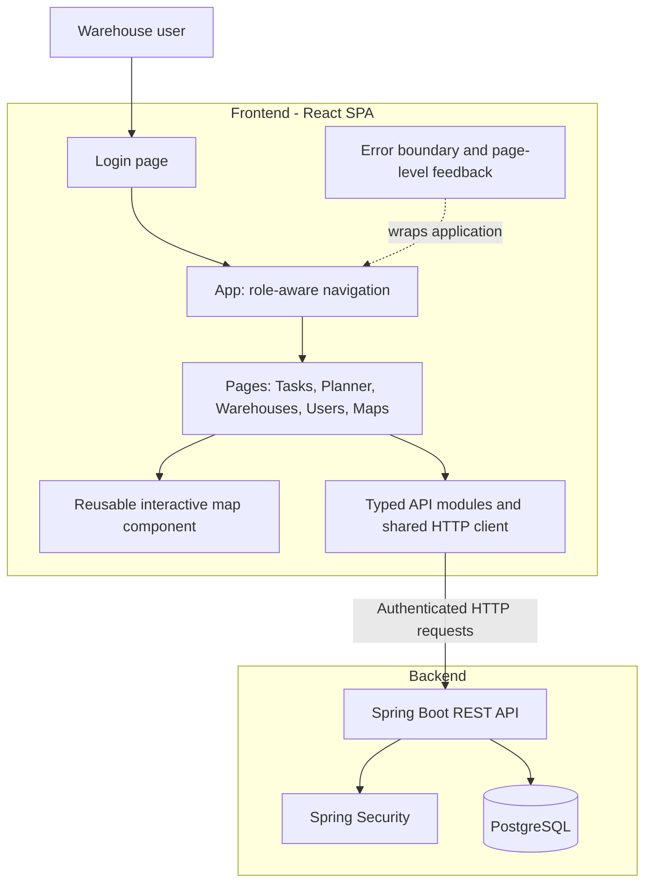
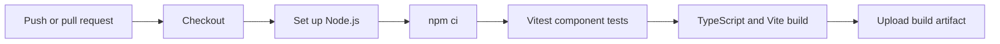

# PickerRoute — Warehouse Picking Frontend

**A role-based warehouse operations interface for assigning picking tasks, exploring warehouse layouts, and comparing collection routes.**

Built as the frontend of the **Warehouse Picker Route Optimization Platform**, a bachelor's project focused on warehouse order-picking workflows and route analysis.

**React 19** · **TypeScript 7** · **Vite 8** · **Spring Boot REST API** · **Vitest** · **Playwright**

> **Project status:** The React frontend, component tests,
> and Playwright end-to-end scenarios have been verified locally.
> The application supports a unified Maven build that packages
> the React frontend and Spring Boot backend into one executable
> JAR. Public deployment has not yet been performed.

## Contents

- [What the application does](#what-the-application-does)
- [How it works](#how-it-works)
- [Architecture](#architecture)
- [Project structure](#project-structure)
- [Technology choices](#technology-choices)
- [Running locally](#running-locally)
- [Forms, loading and error handling](#forms-loading-and-error-handling)
- [Testing](#testing)
- [Continuous integration](#continuous-integration)
- [Current limitations](#current-limitations)
- [Front-end assessment requirements](#front-end-assessment-requirements)

---

## What the application does

PickerRoute has two workspaces. After authentication, the application shows navigation and actions appropriate to the user's role.

| Area | Manager | Picker |
|---|:---:|:---:|
| Role-specific dashboard | Yes | Yes |
| View and manage warehouses | Yes | No |
| Manage user accounts | Yes | No |
| Import and explore warehouse maps | Yes | No |
| Create and assign picking tasks | Yes | No |
| View assigned picking tasks | Yes | Yes, own tasks |
| Start, collect items and complete assigned tasks | No | Yes |
| Calculate and compare picking routes | Yes | Yes, authorized tasks |

### Key screens

**Picking Tasks** — Managers choose a warehouse, an available product, its quantity, and an employee. Pickers work through orders assigned to them, recording collected quantities and task progress.

**Route Planner** — Users select an existing task from a searchable list, calculate a route, and view ordered stops with product names and distances. The page compares a weight-aware heuristic with an S-shape baseline.

**Warehouse Maps** — Managers can import and inspect a warehouse graph using interactive zoom, pan, fullscreen, and node search.

## How it works

### Flow A — Manager prepares and plans an order



**Outcome:** A manager creates an assigned order and can inspect the suggested collection sequence before picking begins.

### Flow B — Picker fulfills an assigned order



**Outcome:** The picker can follow a task through the supported states, from assignment to completion. The task status and collected quantities are handled by the backend.

### Flow C — Route calculation



The **optimized route** is a heuristic: it attempts to improve the picking sequence but **does not guarantee a mathematically global optimum**. The S-shape result is the comparison baseline. The interface reports the calculated result even when both approaches have equal metrics.

---

## Architecture

The application is a **Single Page Application (SPA)**. Page navigation and the currently authenticated role are handled in React. API communication is separated into dedicated modules, while the Spring Boot backend owns authorization, task state, route calculations, and persistence.



### Responsibilities

| Layer | Responsibility | Example files |
|---|---|---|
| Application shell | Authentication state, role-specific navigation | `src/App.tsx`, `src/main.tsx` |
| Pages | User workflows, forms, loading/error presentation | `src/pages/` |
| Components | Reusable interactive UI and rendering fallback | `src/components/` |
| API services | Requests, response types and HTTP error handling | `src/api/` |
| Data types | TypeScript models for routes and warehouse data | `src/types/` |
| Component tests | React behavior verification | `src/test/` |
| Browser tests | Real end-to-end user workflows | `e2e/` |

**Security boundary:** Hiding manager-only navigation improves usability but does not enforce permissions. The backend must independently authorize every protected API operation. The current application uses HTTP Basic authentication; use HTTPS before any public deployment.

## Project structure

```text
warehouse-picker-route-optimization/
├── backend/                         # Spring Boot API
├── frontend/
│   ├── e2e/
│   │   └── warehouse-workflows.spec.ts
│   ├── src/
│   │   ├── api/                     # API clients and request types
│   │   ├── components/
│   │   │   ├── InteractiveWarehouseMap.tsx
│   │   │   └── AppErrorBoundary.tsx
│   │   ├── pages/
│   │   │   ├── LoginPage.tsx
│   │   │   ├── ManagerDashboard.tsx
│   │   │   ├── PickerDashboard.tsx
│   │   │   ├── PickingTasksPage.tsx
│   │   │   ├── RoutePlannerPage.tsx
│   │   │   ├── WarehousesPage.tsx
│   │   │   ├── WarehouseMapsPage.tsx
│   │   │   └── UsersPage.tsx
│   │   ├── test/                    # Vitest + Testing Library
│   │   ├── types/
│   │   ├── App.tsx
│   │   └── main.tsx
│   ├── playwright.config.ts
│   ├── vitest.config.ts
│   ├── vite.config.ts
│   └── package.json
├── .github/workflows/
│   ├── backend-tests.yml
│   ├── frontend-ci.yml
│   └── playwright-e2e.yml
└── README.md
```

## Technology choices

| Technology | Why it is used |
|---|---|
| **React 19** | Component composition, state-driven forms, and reusable UI |
| **TypeScript 7** | Typed API data, clearer contracts, and compile-time checks |
| **Vite 8** | Fast development environment and production bundling |
| **CSS** | Lightweight page-specific styling and responsive layouts |
| **Fetch API** | Browser-native communication with the REST backend |
| **Vitest + React Testing Library** | Fast tests focused on visible component behavior |
| **Playwright** | Verifies authentication, navigation, and workflows in Chromium |

This stack keeps the frontend small and transparent: no additional routing or global state-management library is needed for the current application scope.

---

## Running locally

### Prerequisites

- **Node.js 22.23.5** and npm (compatible with Vite 8).
- **Java 21** and the running Spring Boot backend at `http://localhost:8080`.
- PostgreSQL configured for the backend; test manager and picker accounts created.

Backend setup and database migrations are documented in the repository's backend/API documentation. The frontend cannot authenticate or calculate routes without a working API.

### 1. Install dependencies

From the repository root:

```powershell
cd frontend
npm ci
```

### 2. Start the backend

Start `BackendApplication` in IntelliJ IDEA, or run it using the Maven wrapper with the required database environment variables. Confirm that `http://localhost:8080/actuator/health` is reachable.

### 3. Start the frontend

```powershell
npm run dev
```

Visit **http://localhost:5173** and sign in with a manager or picker account.

### 4. Create a production build

```powershell
npm run build
```

The output is written to `frontend/dist/`. A successful build verifies TypeScript and Vite compilation; publishing the bundle requires a separate deployment step.

### Unified Fullstack Build

In addition to separate frontend development, the platform
supports a unified Maven build.

From the repository root on Windows:

```powershell
cd backend
.\mvnw.cmd -Pfullstack clean verify
```

The Maven profile automatically installs a compatible Node.js
version, installs frontend dependencies, builds the React
application, and packages the resulting static assets into
the Spring Boot executable JAR.

With the required database environment variables configured,
start the application from the backend directory:

```powershell
java -jar target\backend-0.0.1-SNAPSHOT.jar
```

Open http://localhost:8080/ to access the React interface.

The API is available under `/api/**` on the same server.

A separate Vite development server is not needed when using
the unified executable JAR.

The existing `npm run dev` command remains available for
frontend development.

## Forms, loading and error handling

The frontend includes controlled forms for login, warehouse/user administration, task creation, and map import. Field constraints and page-level checks aim to prevent invalid submissions; business rules such as access rights and stock availability are also verified on the backend.

- **Validation:** required fields, numeric quantities, selected entities, and backend validation feedback where applicable.
- **Loading:** asynchronous requests display progress or disabled controls to reduce duplicate submissions.
- **Request errors:** API and page-level error states report failed or unauthorized requests.
- **Unexpected rendering errors:** `AppErrorBoundary` provides a fallback UI when mounted around `<App />` in `src/main.tsx`.

Error boundaries do not catch all asynchronous request failures; those must still be handled by the API layer and callers.

---

## Testing

### Component tests — Vitest

The following tests have been **executed locally and passed**:

| Component | Focus | Passing tests |
|---|---|---:|
| `ManagerDashboard` | Dashboard rendering and navigation action | 2 |
| `PickerDashboard` | Dashboard rendering and authenticated username | 2 |
| `InteractiveWarehouseMap` | Graph rendering, zoom and node lookup | 3 |
| **Total** | **Three key components** | **7 / 7** |

```powershell
npm run test
```

### End-to-end tests — Playwright

Two browser tests have been **executed locally in Chromium and passed**:

1. **Manager workflow:** authentication → Picking Tasks → Route Planner → route calculation → results.
2. **Picker workflow:** authentication → My Picking Tasks, with manager-only navigation hidden.

The tests are located in `e2e/warehouse-workflows.spec.ts`.

```powershell
npx playwright install chromium
npm run test:e2e
```

Playwright needs the backend to be running and the following environment variables to be set in the same terminal:

| Variable | Meaning |
|---|---|
| `E2E_MANAGER_USERNAME` | Manager test account username |
| `E2E_MANAGER_PASSWORD` | Manager test account password |
| `E2E_PICKER_USERNAME` | Picker test account username |
| `E2E_PICKER_PASSWORD` | Picker test account password |

For example, in PowerShell you can enter a password without displaying it:

```powershell
$env:E2E_PICKER_USERNAME = "jordan"
$securePassword = Read-Host "Picker password" -AsSecureString
$env:E2E_PICKER_PASSWORD = [System.Net.NetworkCredential]::new("", $securePassword).Password
```

Repeat for the manager account. **Never commit credentials, `.env` files containing secrets, or Playwright traces that may contain sensitive test data.**

### Latest verified local results

```text
Vitest:      3 test files passed; 7 tests passed
Playwright:  2 tests passed (Chromium)
Build:       npm run build succeeded
```

## Continuous integration



### Verified CI Results

All three GitHub Actions workflows completed successfully:

- Backend Tests — passed.
- Frontend CI — passed.
- Playwright E2E — passed.

The Frontend CI workflow verifies the seven Vitest tests
and the production Vite build.

The Playwright E2E workflow uses an isolated PostgreSQL
database to execute the manager and picker browser scenarios.

The two Playwright E2E scenarios have been verified locally.

A separate workflow, `.github/workflows/playwright-e2e.yml`,
is configured to run browser tests with a temporary
PostgreSQL database and Spring Boot backend.

Successful execution of the new workflow in GitHub Actions
has not yet been verified.

The unified fullstack Maven build has also been verified
locally, including 93 passing backend tests and the
JaCoCo coverage quality gate.

[View repository Actions](https://github.com/Vladkosheliuk/warehouse-picker-route-optimization/actions)

## Current limitations

- The demo warehouse initially contains a limited set of sample products. Adding arbitrary catalog products and assigning physical storage locations is a separate inventory-management workflow.
- Route calculations use the currently available warehouse data and do **not** save a calculated route in the database.
- The weight-aware routing method is a **heuristic**, not a proof of globally shortest or minimum-load-distance routing.
- The public application URL is not yet available; the validated execution environment is local.

## Front-end assessment requirements

| Requirement | Evidence |
|---|---|
| Modern framework and bundler | React SPA, TypeScript, Vite |
| Architecture diagram | [Architecture](#architecture) |
| User flows | [How it works](#how-it-works) |
| Technology stack justification | [Technology choices](#technology-choices) |
| Components, pages, API service modules | [Project structure](#project-structure) |
| Validation, errors, loading | [Forms, loading and error handling](#forms-loading-and-error-handling) |
| Tests for at least three key components | 3 components; 7 passing Vitest tests |
| 1–2 E2E tests | 2 passing Playwright tests |
| README and run instructions | [Running locally](#running-locally) |
| Repository access | [GitHub repository](https://github.com/Vladkosheliuk/warehouse-picker-route-optimization) |
| Public app link | Not available yet (optional if not deployed) |

---

**Repository:** [Vladkosheliuk/warehouse-picker-route-optimization](https://github.com/Vladkosheliuk/warehouse-picker-route-optimization) · **Frontend path:** `frontend/`

*Bachelor's project · 2026*